# GraceERP Solution: platform

This kit runs a ZATCA-compliant accounting service for many customer businesses from one server, like Alostaz.io. Each customer (tenant) gets:

- their own site, with a separate database;
- their own address, such as `acme.erp.gracelinkgroup.com` or their own domain;
- a subscription plan that limits users, invoices, warehouses, companies and HR.

Everything customers see carries the GraceERP Solution name and logo: screens, menus, the About dialog, emails and the website footer. Arabic is the default, with full right-to-left layout.

**Two ways to buy GraceERP Solution:**
- **Monthly subscription:** the customer is a tenant on this platform, hosted, maintained and supported 24/7 by GraceERP, and limited by their plan. `new-tenant.sh` marks every tenant this way (`grace_license = subscription`), and `update.sh` marks tenants created earlier.
- **Lifetime licence:** paid once. The customer runs GraceERP Solution on their own server, so not on this platform, with `grace_license = lifetime` and no limits.

`list-tenants.sh` shows each tenant's licence next to its plan.

## Demo

These screenshots are from a real demo tenant ("Al Noor Trading"), created with one command and filled with sample data:

```bash
./scripts/demo-tenant.sh            # creates demo.<your domain> and prints the login
```

| | |
|---|---|
| 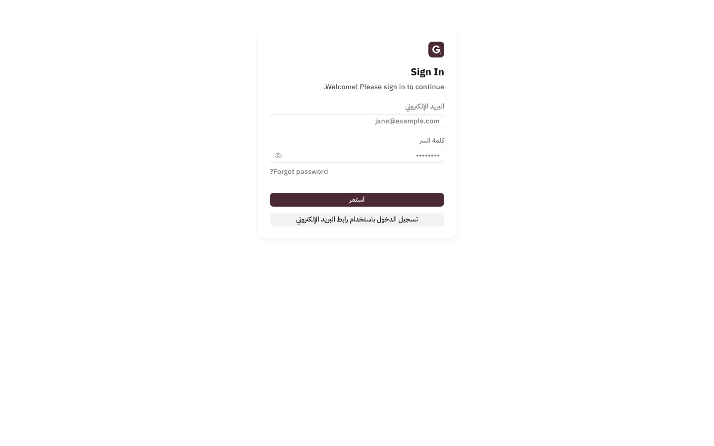 **Branded sign-in page** | 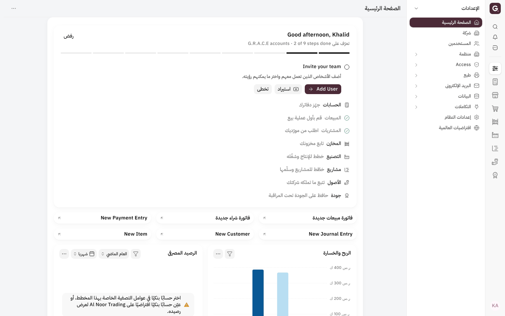 **Home, Arabic (RTL)** |
| 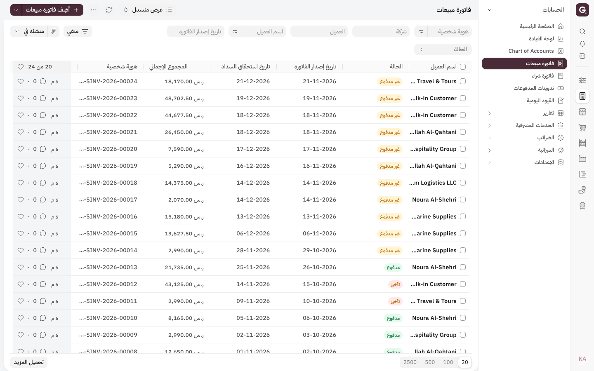 **Sales invoices with 15% VAT, paid / unpaid / overdue** | 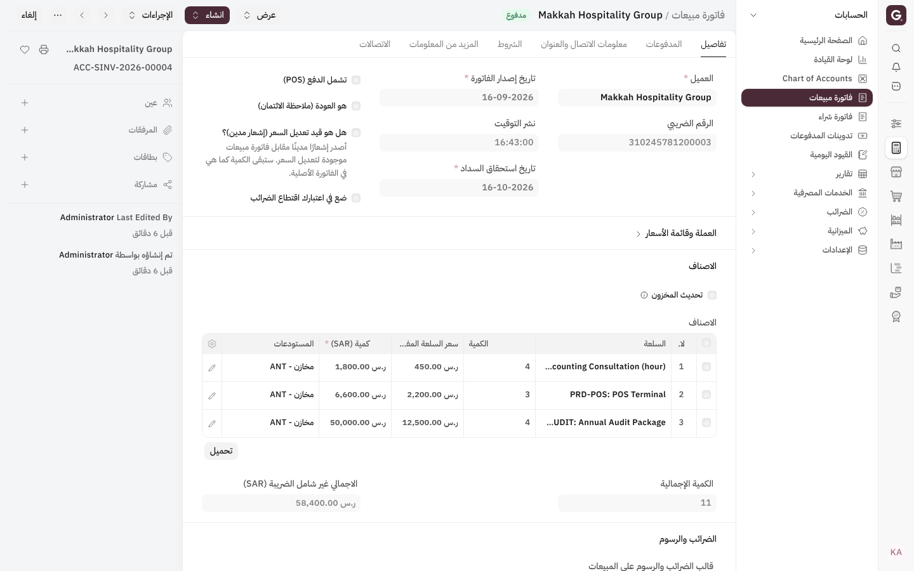 **A B2B invoice with the customer's VAT number** |
| 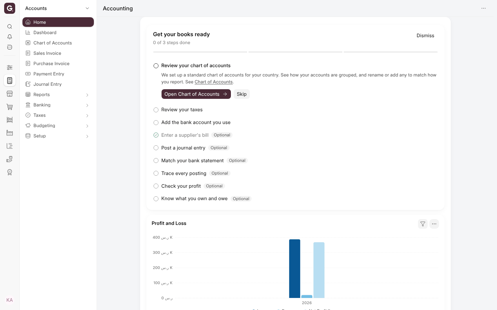 **Accounting home in English, with profit and loss** | 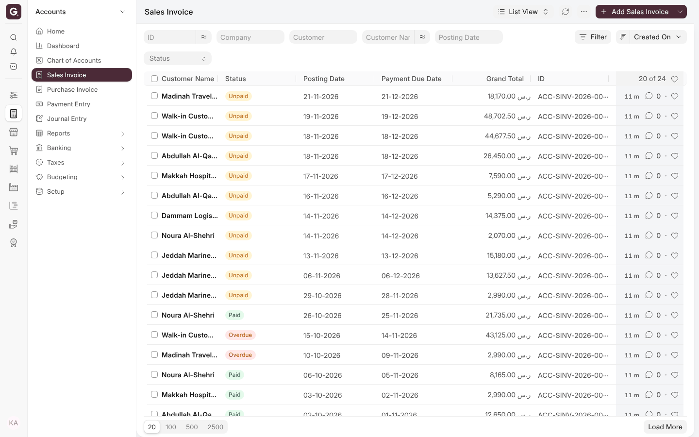 **The same invoices in English** |
| 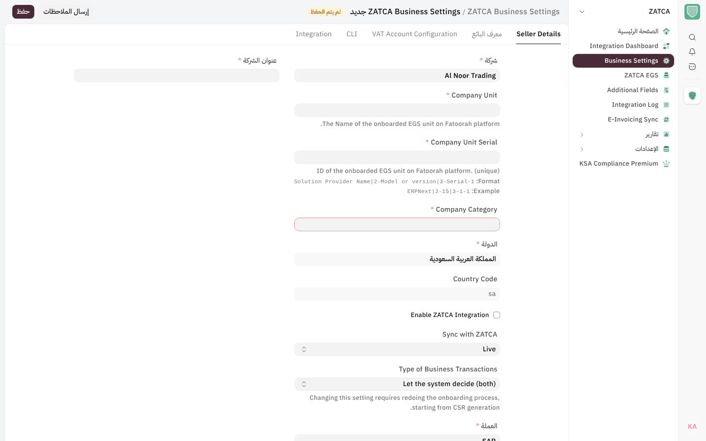 **ZATCA e-invoicing onboarding (Phase 1 and 2)** | 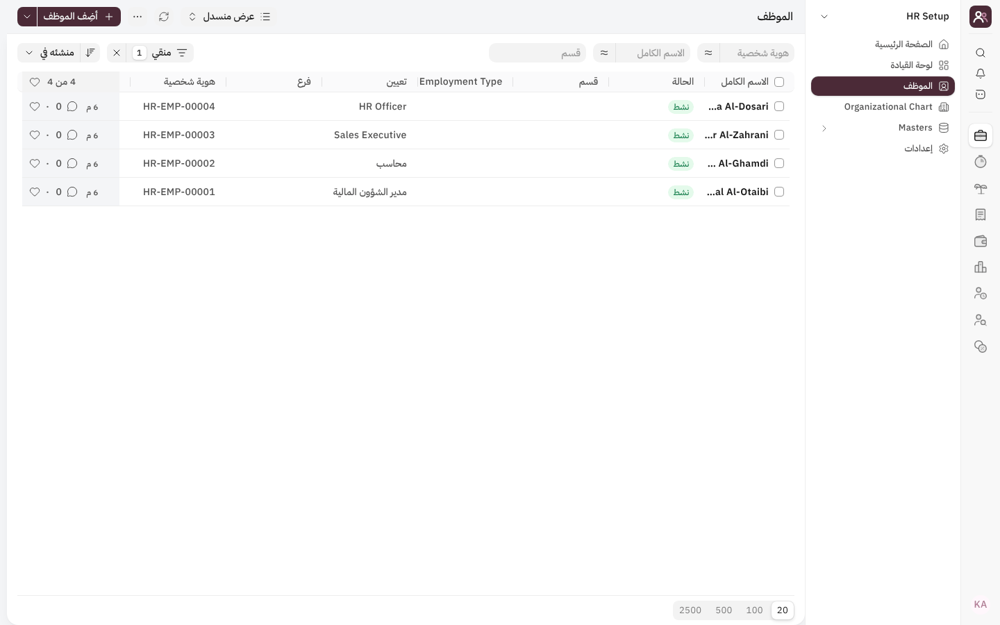 **HR: employees (Comprehensive plan)** |
| 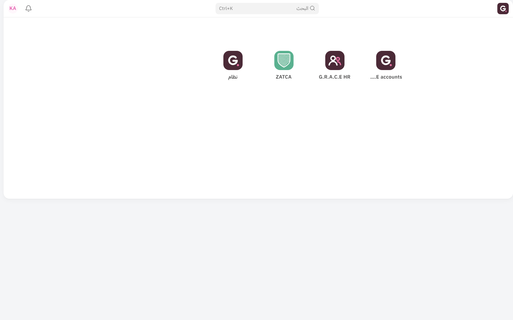 **App switcher: accounts, HR, ZATCA** | 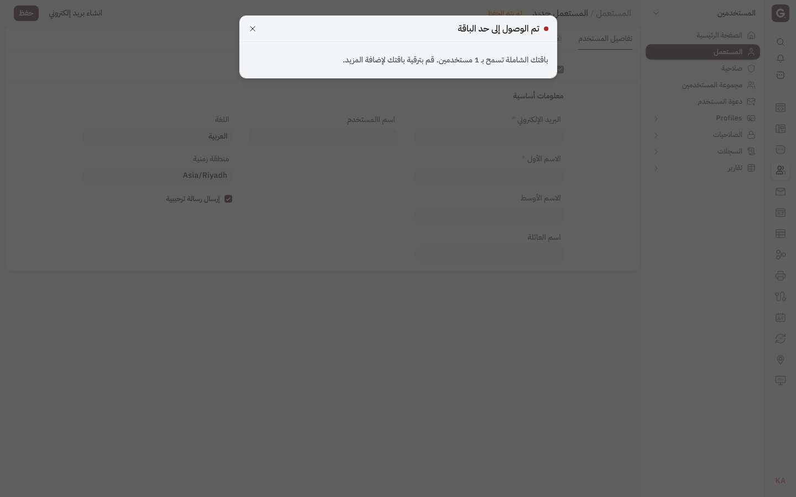 **Plan limit reached: upgrade message in Arabic** |
| 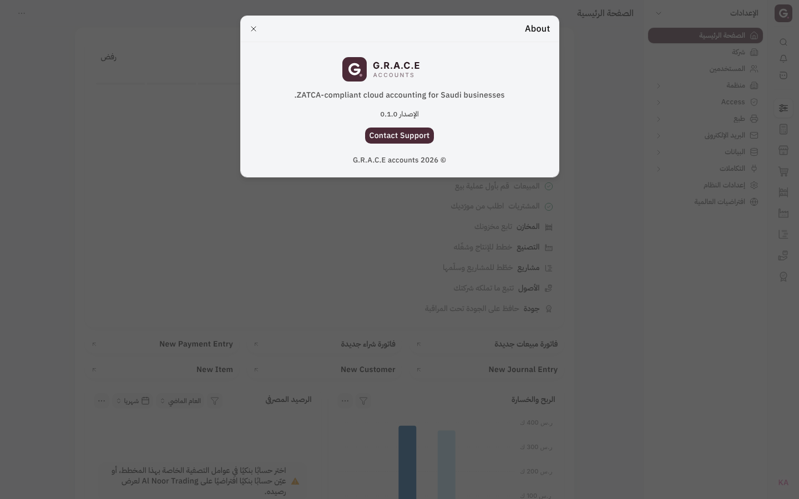 **Your About dialog and support link** | 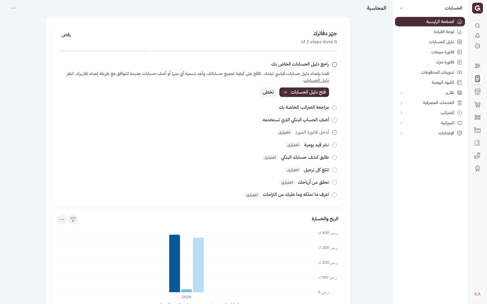 **Accounting home, Arabic** |

The demo data includes:
- 8 Saudi customers (5 businesses with VAT numbers, 3 individuals) and 3 suppliers;
- 9 products and services;
- a 15% VAT template;
- 24 sales invoices and 9 purchase invoices over 3 months, with 17 payments;
- 4 employees.

To remove a demo: `./scripts/delete-tenant.sh demo`.

| Included app | What customers get |
|---|---|
| **ERPNext v16** | Accounting, invoicing, POS, inventory, purchasing, treasury and banking, cost centers, VAT and financial reports, multi-branch |
| **HRMS v16** | Payroll, leave, attendance, advances, expenses, recruitment (Comprehensive plan) |
| **KSA Compliance** | ZATCA e-invoicing, Phase 1 and Phase 2: clearance, reporting, QR codes, onboarding wizard |
| **grace_accounting** | Your branding and theme, Arabic-first setup, subscription plans |

## 1. Server

- **Server:** Ubuntu 22.04 or 24.04, 4 vCPU, 8 GB RAM and 80 GB SSD to start. Add RAM and CPU as tenants grow. A Saudi data center is preferable for data residency.
- **Docker:** install Docker Engine with the Compose plugin (https://docs.docker.com/engine/install/ubuntu/).
- **DNS:**
  - `A  erp.gracelinkgroup.com` → the server IP
  - `A  *.erp.gracelinkgroup.com` → the server IP (the wildcard, so every tenant subdomain works)

## 2. Install (once)

```bash
git clone --branch platform https://github.com/isabella-grimes/gracelink-account /opt/grace-platform
cd /opt/grace-platform
./scripts/install.sh          # creates .env with a generated DB password
nano .env                     # set PLATFORM_DOMAIN, LETSENCRYPT_EMAIL and SUPPORT_URL
./scripts/install.sh          # builds the image (10-20 min) and starts everything
```

For faster installs, let GitHub build the image. The workflow in `.github/workflows/build-image.yml` publishes it to `ghcr.io/<owner>/grace-accounts`. Then set in `.env`:

```
GRACE_IMAGE=ghcr.io/isabella-grimes/grace-accounts
PULL_POLICY=always
```

(If the GitHub package is private, run `docker login ghcr.io` on the server once.)

## 3. Run the business

| Task | Command |
|---|---|
| New customer | `./scripts/new-tenant.sh acme --company "Acme Trading" --email owner@acme.sa --name "Ahmed Ali" --plan basic` |
| Customer with own domain | `./scripts/new-tenant.sh erp.acme.sa --company ... ` (point their DNS A record at the server first) |
| Change plan | `./scripts/set-plan.sh acme comprehensive` |
| Custom limits | `./scripts/set-plan.sh acme basic --limits '{"users": 8, "hr": true}'` |
| See all customers and usage | `./scripts/list-tenants.sh` |
| Back up (all or one) | `./scripts/backup.sh` / `./scripts/backup.sh acme` |
| Restore | `./scripts/restore-tenant.sh acme backups/<date>/acme.erp.gracelinkgroup.com` |
| Update everything | `./scripts/update.sh` (backs up, rebuilds or pulls, migrates every tenant) |
| Delete a customer | `./scripts/delete-tenant.sh acme` (backs up first, asks for confirmation) |
| Demo company with sample data | `./scripts/demo-tenant.sh` |

`new-tenant.sh` takes about a minute and a half. It:
- creates the site and installs all the apps;
- sets the plan;
- completes setup in Arabic with SAR, the Asia/Riyadh timezone and a January–December fiscal year;
- creates the owner's login and prints the login details to send them.

The Administrator password stays with you, in `tenants/<site>.txt`. Customers use their owner account, so plan limits apply to them.

**Customer's first step:** log in, open **ZATCA Business Settings**, and onboard with the OTP from the Fatoora portal. Test in the simulation environment first, then switch to production.

## 4. Plans

| | Economic | Basic | Comprehensive |
|---|---|---|---|
| Users | 2 | 5 | 15 |
| Invoices / month (sales + POS) | 300 | 2,000 | Unlimited |
| Warehouses | 1 | 3 | 10 |
| Companies | 1 | 2 | 5 |
| HR and payroll (payroll, leave, attendance, expenses, recruitment) | – | – | ✓ |

To change the default numbers, edit `PLANS` in `grace_accounting/plans.py` (the `grace_accounting` branch) and run `update.sh`. Plan changes take effect within a minute. When a customer hits a limit, they see a clear message in Arabic or English asking them to upgrade.

Employee records themselves are part of core accounting (they're also used for sales staff), so every plan has them. Customer-portal (website) users and the Administrator don't count as users. ERPNext's automatic default warehouses don't count either; the main store counts as 1.

## 5. Support link

Set `SUPPORT_URL` in `.env` to a WhatsApp link, website or `mailto:` address. It appears in every tenant's Help menu and About dialog. After changing it, run `./scripts/update.sh`.

## 6. Backups

Run nightly from cron, and copy `backups/` off the server. For example, rclone to Backblaze B2, S3 or Google Drive:

```
0 2 * * * cd /opt/grace-platform && ./scripts/backup.sh >> backups/backup.log 2>&1
30 2 * * * rclone sync /opt/grace-platform/backups remote:grace-backups
```

Local copies are kept for 14 days. ZATCA requires invoice records to be kept for years, so the off-site copy matters.

## How this was tested

The whole kit was run end to end on Docker, with a demo tenant and test tenants:
- `new-tenant.sh`, `demo-tenant.sh` and `set-plan.sh`;
- each limit: users, warehouses, companies, and HR, checked on real payroll and leave records;
- `list-tenants.sh`, `backup.sh`, `restore-tenant.sh` and `delete-tenant.sh`;
- migrate, with branding re-applied afterwards;
- a scan of every main screen, logged in and logged out, for upstream product names.

Not covered:
- **The full image build (`build.sh` / GitHub Actions).** The test environment couldn't reach `codeload.github.com`, so tests ran on the official v16 image with the same apps added.
- **HTTPS certificates.** These need a real domain.
- **Live ZATCA submission.** This needs a Fatoora OTP and access to ZATCA's servers.

## Not included yet

- **Self-service signup and online payment.** Customers can't yet sign up and pay by card, mada or Apple Pay. You create tenants with `new-tenant.sh` after they pay. This is the natural next build: a signup page that charges through Moyasar or Tap and calls the same steps.
- **Saudi payroll specifics.** GOSI contributions and Mudad WPS files aren't in open-source HRMS. Salary structures can model GOSI manually.
- **Plan limits on API access.** API access isn't limited by plan; any user can create API keys.
